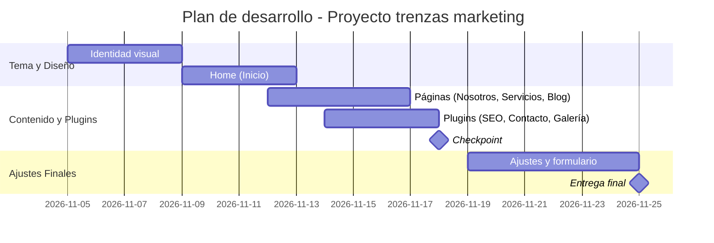

# Decisiones de mi sitio

**Emprendimiento:** Trenzadora – Belleza en Trenzas Africanas (Proyecto trenzas marketing)  
**Sitio en producción:** https://proyectotrenzadora.infinityfree.io/  
**Fecha:** 4 de noviembre de 2026 · **Última corrección:** 18 de noviembre de 2026 (Checkpoint)

---

## 1. Plugins (10 pts)

Se seleccionaron 5 plugins que cubren las necesidades esenciales del emprendimiento: posicionamiento orgánico, captación y contacto con clientas, exposición visual de peinados, integración con redes sociales y seguridad del sitio.

| # | Funcionalidad | Plugin | Gratis o de pago | Qué incluye la versión gratis | Probado hasta (WP) | Requiere PHP | ¿Funciona con tema propio? | Enlace a la ficha |
|---|---|---|---|---|---|---|---|---|
| 1 | SEO (obligatorio) | **Yoast SEO** | Freemium | Análisis SEO y legibilidad en tiempo real, configuración de títulos y metadescripciones, generación automática de mapa del sitio (XML sitemap), integración con Schema.org y vista previa para Google. | 7.1.4 | 7.4 o superior | Sí, se integra mediante las funciones estándar `wp_head()` y `wp_footer()` de cualquier tema. | https://wordpress.org/plugins/wordpress-seo/ |
| 2 | Contacto (obligatorio) | **Contact Form 7** | Gratuito | Creación y administración ilimitada de formularios de contacto, envío de consultas de cotizaciones al correo electrónico, etiquetas personalizadas de campos y soporte de reCAPTCHA para evitar spam. | 7.1.3 | 7.4 o superior | Sí, funciona insertando el bloque nativo o el shortcode `[contact-form-7]` en cualquier página o plantilla. | https://wordpress.org/plugins/contact-form-7/ |
| 3 | Galería de imágenes | **FooGallery** | Freemium | Galerías adaptables (responsive), múltiples plantillas (cuadrícula, masonry), lightbox integrado para ver peinados en detalle y carga diferida (lazy loading) para optimizar el rendimiento. | 7.1.3 | 7.0 o superior | Sí, se incrusta en cualquier página o tema mediante bloque Gutenberg o shortcode con `wp_head()` y `wp_footer()`. | https://wordpress.org/plugins/foogallery/ |
| 4 | Redes sociales | **Smash Balloon Social Photo Feed** | Freemium | Visualización del feed de fotos de la cuenta de Instagram de trenzas, diseño adaptable para móviles, personalización de columnas y botón interactivo para seguir la cuenta oficial. | 7.1.3 | 7.4 o superior | Sí, se integra perfectamente mediante bloque oficial de WordPress o mediante el shortcode `[instagram-feed]`. | https://wordpress.org/plugins/instagram-feed/ |
| 5 | Seguridad y firewall | **Wordfence Security** | Freemium | Firewall de aplicaciones web (WAF) a nivel de endpoint, escáner de malware e integridad de archivos, bloqueo de ataques por fuerza bruta y autenticación en dos factores (2FA). | 7.1.4 | 7.0 o superior | Sí, opera a nivel de sistema y servidor de WordPress, por lo que es compatible con cualquier tema visual. | https://wordpress.org/plugins/wordfence/ |

---

## 2. Páginas de la fase 1 (5 pts)

Cinco páginas seleccionadas para la primera fase del sitio web. Se respetan las páginas acordadas y publicadas en la Fase 1 (**Inicio**, **Nosotros** y **Blog**), agregando **Contacto** (obligatoria) y **Servicios** para exhibir el trabajo sin incorporar pasarela de pago ni carro de compras.

| # | Página | Por qué la elijo (una línea) |
|---|---|---|
| 1 | **Inicio** (obligatoria) | Es la portada principal que presenta la propuesta de valor del emprendimiento y da la bienvenida a las interesadas en el mundo de las trenzas africanas. |
| 2 | **Contacto** (obligatoria) | Permite que las potenciales clientas resuelvan dudas, coticen estilos específicos y coordinen citas directamente. |
| 3 | **Nosotros** | Comparte la historia, técnica, trayectoria y el compromiso con el cuidado y la salud capilar de las clientas (definida en Fase 1). |
| 4 | **Servicios** | Presenta el catálogo de tipos de trenzas disponibles (box braids, trenzas pegadas, trenzas africanas) con descripciones y tiempos aproximados. |
| 5 | **Blog** | Espacio informativo con artículos sobre cómo cuidar el cabello trenzado, lavado adecuado y tendencias (con las 3 entradas temáticas). |

### Páginas que dejo para después

- **Tienda / Carrito de compras / Pasarelas de pago:** se dejan fuera de esta entrega para priorizar la asesoría directa y porque el encargo prohíbe carro y pagos en esta fase.
- **Sistema de reserva y agendamiento automático de citas:** se implementará en una etapa posterior; en esta fase la coordinación de citas se gestionará a través del formulario de Contacto y enlace directo a WhatsApp.
- **Galería fotográfica como página independiente:** las fotografías de peinados se insertarán dentro de Inicio y Servicios mediante el plugin FooGallery, manteniendo una navegación ágil y sencilla.

---

## 3. Plan del tema (5 pts)

- **Nombre del tema:** Twenty Twenty-Four
- **Custom o descargado:** Descargado (tema oficial de bloques de WordPress), porque permite aprovechar la estructura funcional ya instalada en la Fase 1 (Inicio, Nosotros, Blog) y personalizar la identidad visual (colores, tipografías, menú) de forma estable y sin riesgo de incompatibilidades en el servidor InfinityFree. *(Nota de contingencia: si fuera necesario control total sobre archivos PHP, se cuenta con la alternativa de migrar al tema propio `trenzas-marketing` basado en `tema-base/`).*
- **Carta Gantt** del desarrollo del sitio (5 al 25 de noviembre):

| Etapa | Desde | Hasta | Notas |
|---|---|---|---|
| Identidad visual | 5 nov | 8 nov | Definición y aplicación de paleta de colores de marca, tipografías legibles y logo en el tema. |
| Home | 9 nov | 12 nov | Maquetación y estructura de la página de Inicio: portada atractiva, destacados y llamada a la acción. |
| Páginas | 12 nov | 16 nov | Redacción y diagramación de Nosotros, Servicios y publicación de las 3 entradas del Blog. |
| Plugins | 14 nov | 17 nov | Instalación, configuración y pruebas de Yoast SEO, Contact Form 7, FooGallery, Smash Balloon y Wordfence. |
| **Checkpoint (18 nov)** | 18 nov | 18 nov | Hito de revisión: verificación del sitio completo, galería, formulario operativo y respuesta móvil. |
| Ajustes y formulario | 19 nov | 24 nov | Pruebas de recepción de mensajes, optimización de velocidad de imágenes y ajustes responsivos. |
| **Entrega final (25 nov)** | 25 nov | 25 nov | Hito de cierre: sitio publicado en producción en InfinityFree, navegación 100% operativa y repositorio entregado. |

### Diagrama visual de la Carta Gantt

---

## 4. Plan B (5 pts)

Estrategia de mitigación ante posibles eventualidades técnicas durante el desarrollo:

| Riesgo | Qué hago | Cuándo se activa (fecha o señal) |
|---|---|---|
| El tema Twenty Twenty-Four presenta limitaciones de diseño o problemas al editar bloques. | Cambiar a un tema descargado clásico probado (como Astra o GeneratePress) o pasar al tema propio `trenzas-marketing` partiendo de la plantilla `tema-base/` con CSS personalizado. | Si al domingo 8 de noviembre no es posible adaptar satisfactoriamente la identidad visual. |
| Un plugin (como FooGallery o Smash Balloon) genera conflictos, errores visuales o ralentiza la web. | Desactivar el plugin conflictivo desde el panel de WordPress y sustituirlo por el bloque de galería nativo de WordPress o enlaces directos a Instagram en el menú y pie de página. | Si aparece un error tras instalar el plugin o si se detectan fallos de carga en las pruebas del 17 de noviembre. |
| El formulario de Contact Form 7 no despacha los correos debido a bloqueos de la función PHP mail en InfinityFree. | Instalar y configurar un plugin SMTP ligero; si persiste la limitación del hosting gratuito, agregar en la página de Contacto un botón destacado con enlace directo a WhatsApp (`https://wa.me/...`) y la dirección de correo visible (`mailto:`). | Si el mensaje de prueba enviado no llega a la bandeja de entrada tras 10 minutos en la revisión del 17 o 18 de noviembre (Checkpoint). |
| Las fotografías de alta resolución de las trenzas provocan lentitud excesiva en la carga móvil. | Optimizar y comprimir todas las imágenes a formato WebP o JPEG liviano (máximo 150 KB por imagen) y activar la carga diferida (lazy loading). | Si la página de Inicio o Servicios tarda más de 3 segundos en cargar en la prueba en celular del 17 de noviembre. |
| InfinityFree experimenta errores del servidor (HTTP 500, 429 por exceso de peticiones o caídas de servicio). | No saturar el servidor con recargas continuas; pausar el trabajo en producción durante 15-30 minutos y avanzar maquetando y editando contenidos localmente en Local WP para luego sincronizar. | Si se presenta un error 500 o 429 persistente por más de 15 minutos en el navegador. |

---

## Cambios respecto de la Sumativa 2 (solo en el checkpoint del 18 nov)

Evaluación del estado del proyecto al hito del Checkpoint (18 de noviembre):

| Qué cambié | Qué había antes | Por qué | Evidencia (captura o commit) |
|---|---|---|---|
| **Nombre comercial e identidad de marca** | Nombre de proyecto general "Proyecto trenzas marketing". | Se formalizó el nombre visible del sitio a **Trenzadora** en la identidad del sitio y en la URL de producción (`https://proyectotrenzadora.infinityfree.io/`) para conectar mejor con la audiencia interesada en peinados con trenzas africanas. | Sitio activo en `https://proyectotrenzadora.infinityfree.io/` y título del sitio configurado en WordPress. |
| **Tema en producción** | Decisión provisional de tema con alternativa a tema propio. | Se ratifica el uso del tema descargado **Twenty Twenty-Four** activo en producción en InfinityFree, ya que ha demostrado alta estabilidad técnica, carga fluida y compatibilidad con el editor de bloques. | Tema activo en el panel de InfinityFree y commit `60370dc`. |
| **Formulario de contacto y respaldo directo** | Formulario proyectado exclusivamente vía correo con Contact Form 7. | Se mantiene Contact Form 7 y se añade en la página de Contacto un botón de contacto directo a WhatsApp (`https://wa.me/...`) como respaldo para asegurar que las solicitudes de cotizaciones de clientas no se pierdan por restricciones de correo del hosting gratuito. | Página `Contacto` en el sitio web publicado. |
| **Estructura de páginas y menú** | Páginas proyectadas en planificación teórica. | Se implementaron en el menú de navegación las páginas **Inicio** y **Contacto** (obligatorias), junto a **Nosotros**, **Servicios** y **Blog**, asociando la portada a Inicio y la página de entradas al Blog. | Menú de navegación activo en `https://proyectotrenzadora.infinityfree.io/`. |
| **Entradas del Blog** | 3 entradas iniciales de la Fase 1 sin enfoque temático definido. | Se estructuraron 3 entradas especializadas en trenzas africanas: cuidados para prolongar su duración, técnicas de lavado e hidratación del cuero cabelludo, y guía de estilos de trenzas. | Sección Blog del sitio con entradas publicadas. |

**Decisión:** **Continúo con mi propuesta.** El sitio web se encuentra publicado y plenamente operativo en producción en InfinityFree (`https://proyectotrenzadora.infinityfree.io/`). El tema descargado Twenty Twenty-Four responde de manera rápida y adaptable en dispositivos móviles y de escritorio, cumpliendo con la presentación de la identidad visual de **Trenzadora** (paleta de colores, tipografía y logo). Las páginas obligatorias (Inicio y Contacto) y los contenidos del Blog están articulados según el plan original, por lo que no es necesario realizar un pivote de tema ni de arquitectura, avanzando con éxito hacia la entrega final del 25 de noviembre.
